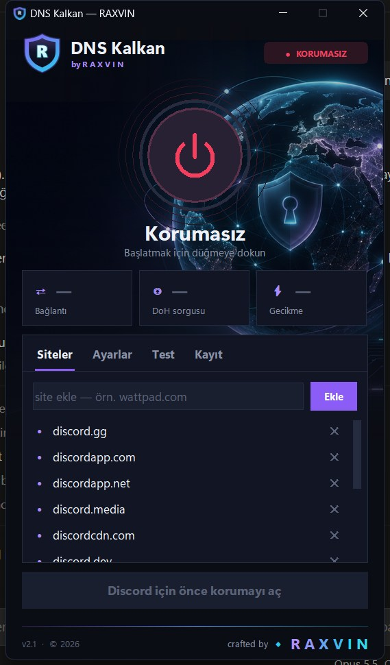

<div align="center">


# DNS Kalkan

**Discord ve engelli siteler için tek tıkla akıllı tünel — Windows 10 / 11**

[](https://github.com/raxvin/dns-kalkan/releases/latest)
&nbsp;

&nbsp;




<sub>crafted by <b>W E S A R</b></sub>

</div>

---

## İndir ve çalıştır

1. **[Releases](https://github.com/raxvin/dns-kalkan/releases/latest)** sayfasından `DNS_Kalkan_v2.1_RAXVIN.zip` dosyasını indir.
2. Zip'i bir klasöre çıkar (sağ tık → **Tümünü ayıkla**).
3. **`DNS Kalkan.exe`**'ye çift tıkla. Python veya başka bir kurulum gerekmez.
   - Windows "bilgisayarınızı korudu" derse: **Ek bilgi → Yine de çalıştır**. Program dijital imzalı olmadığı için yeni programlarda bu uyarı olağandır. Kaynak kodun tamamı bu depoda.
4. Ortadaki büyük düğmeye bas. Yeşil **Korumalı** yazısı göründüğünde hazırsın; Discord kendiliğinden tünelle açılır.

## Özellikler

- **Tek tuşla aç/kapat:** Durum, açık kalma süresi ve canlı istatistikler ana ekranda.
- **Şifreli DNS (DoH):** Seçtiğin sitelerin adresleri ISS'nin DNS'i yerine Cloudflare, Google, AdGuard, OpenDNS ya da **kendi sunucundan** şifreli olarak alınır.
- **SNI bölme:** Bağlantının ilk TLS paketi site adının ortasından bölünür, böylece DPI cihazı site adını okuyamaz.
- **Seçici:** Yalnızca listedeki siteler tünelden geçer. Oyunlar ve diğer her şey doğrudan gider; **ping değişmez**.
- **Discord profili hazır.** Başka siteleri arayüzden ekleyip çıkarabilirsin.
- **Güvenli geri dönüş:** Açarken Windows proxy ayarlarını yedekler, kapatınca geri yükler. Program çökse ya da bilgisayar kapansa bile bir sonraki açılışta ayarlar kendiliğinden düzelir. `kurtarma.bat` her zaman elinin altında.
- **Yönetici izni istemez,** sistem DNS ayarlarına ve ağ bağdaştırıcılarına dokunmaz.
- **Dahili test:** ISS DNS'i, şifreli DNS ve Discord tünelini tek tuşla kontrol eder.

## Nasıl çalışır?

```
Discord / tarayıcı ──► Windows PAC: site listede mi?
                         │ evet                          │ hayır
                         ▼                               ▼
             127.0.0.1:8881 (DNS Kalkan)          doğrudan internet
              1) adresi DoH ile çöz               (oyunlar ve diğer her şey)
              2) TLS ClientHello'yu böl
              3) gerçek sunucuya ilet
```

Bazı sağlayıcılar engellediği siteleri iki katmanda engeller:

| Katman | Belirti | DNS Kalkan |
|---|---|---|
| DNS | Sahte bir adres dönüyor (ör. `195.175.254.2`) | ✓ Şifreli DNS ile aşılır |
| SNI / DPI | Doğru adrese bağlanınca bile site adı görülünce bağlantı kesiliyor | ✓ ClientHello bölünerek aşılır |
| IP | Sunucunun adresi tamamen kapalı | ✗ VPN gerekir |

Discord masaüstü uygulaması, `HTTPS_PROXY` ortam değişkeni ve `--proxy-server` parametresiyle başlatılır. Discord'un güncelleyicisi sistem proxy ayarını kullanmadığı için bu gereklidir.

## Sık sorulanlar

**Discord "güncelleniyor" ekranında takılıyor.**
Discord'u masaüstü kısayolundan değil, uygulamadaki **"Discord'u tünelle başlat"** düğmesiyle aç (ya da Ayarlar'dan otomatik başlatmayı açık tut).

**Benim hattımda çalışıyor mu?**
**Test** sekmesinde "Testi çalıştır"a bas. "Discord tüneli" satırında yeşil tik görmelisin.

**Sesli kanal çalışıyor mu?**
Ses trafiği UDP ile Discord ses sunucularına doğrudan gider. Ses sunucuları IP düzeyinde engellenmedikçe çalışır.

**Oyunlarda ping artar mı?**
Hayır. Oyunlar tünelden geçmez. Açık ve kapalı durumdaki ölçümlerde fark, normal dalgalanmanın (±1–2 ms) altında kaldı.

**Opera GX / tarayıcı VPN'i?**
Tarayıcının kendi VPN'i açıksa sistem proxy ayarı devre dışı kalır; DNS Kalkan kullanırken kapat.

**Bir şey ters giderse?**
`kurtarma.bat`'a çift tıkla. Windows proxy ayarlarını DNS Kalkan'dan önceki hâline getirir.

## Kaynaktan çalıştırma / derleme

```bash
python dns_kalkan.py
```

Python 3.10 veya üstü yeterli; ek paket gerekmez.

`.exe` paketini kendin derlemek için:

```bash
python -m pip install --user pyinstaller
```

```bash
powershell -ExecutionPolicy Bypass -File paket\derle.ps1
```

| Dosya | Görevi |
|---|---|
| `dns_kalkan.py` | Uygulamanın tamamı (arayüz, DoH istemcisi, SNI bölücü proxy, yedekleme) |
| `DNS_Kalkan.bat` / `kurtarma.bat` / `discord_dpi.bat` | Kaynak koddan çalıştırırken kısayollar |
| `gorseller/` | Simge, arka plan ve bunları üreten betikler |
| `paket/` | `.exe` derleme betiği, sürüm bilgisi, BENİOKU |

## Sorumluluk

DNS Kalkan; kişisel kullanım, gizlilik ve erişim amacıyla yapılmış açık kaynaklı bir araçtır. Kullanımından doğan sorumluluk kullanıcıya aittir.

---

<div align="center"><sub>© 2026 <b>RAXVIN</b></sub></div>
